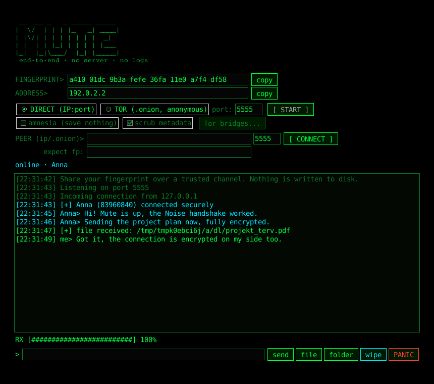
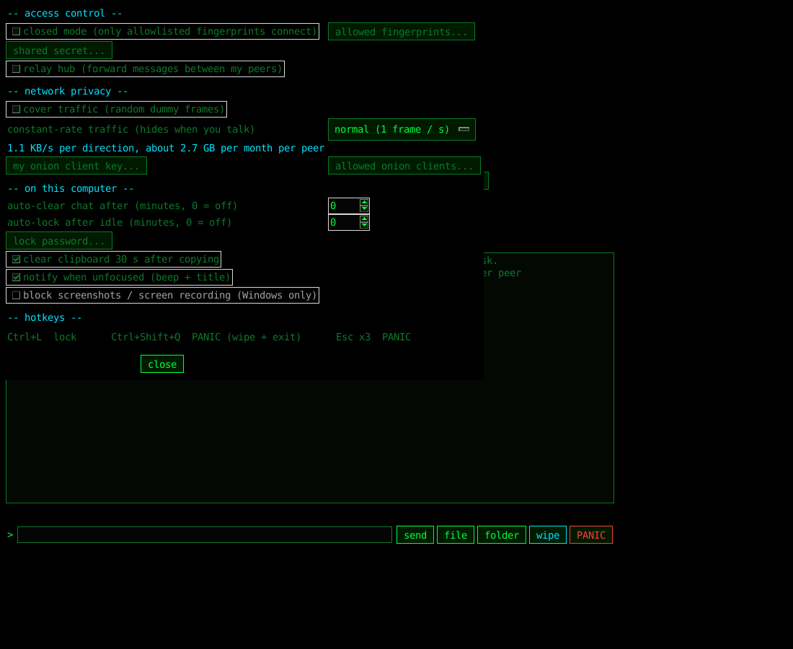
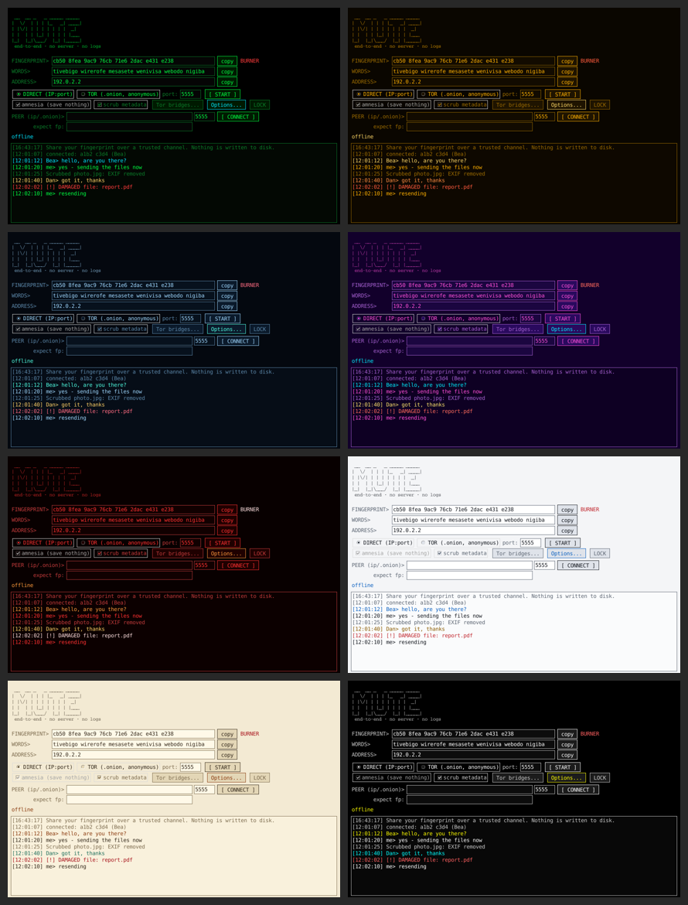

# Mute

Serverless, end-to-end encrypted chat and file/folder transfer with a hacker-style GUI and a terminal mode.
No account, no server, no logs. Connect by exchanging an address (IP or `.onion`) and a fingerprint.



<details><summary>Options window</summary>



</details>

## Features

- **Peer-to-peer**: two (or more) people connect directly; nothing is stored on any server.
- **Two network modes**
  - **DIRECT** - plain TCP to `IP:port` (LAN, port forward, or any VPN address such as Tailscale/WireGuard).
  - **TOR** - built-in onion service: works across networks and through NAT without port forwarding, and hides both IP addresses. Optional **bridges** (obfs4, meek_lite, snowflake) hide that you use Tor.
- **Strong, standard cryptography**: Noise_XX_25519_ChaChaPoly_SHA256 handshake, mutual authentication, forward secrecy, identities encrypted on the wire, symmetric key ratchet plus a fresh Diffie-Hellman key renewal every ~10 minutes, message padding.
- **Files and folders**: large files in chunks with speed/ETA, **resumable** after an interruption, folders sent as a clean zip.
- **Metadata scrubbing** (on by default) for outgoing files - see below.
- **Group chat**: connect to several peers; messages and files go to everyone you are connected to (full mesh, or via a relay hub).
- **Know who is writing**: every peer is identified by its cryptographic key. When someone connects you give them a name
  (only you see it; it is not sent, not saved, and a peer cannot choose or fake it). Each peer gets its own colour.
  Unnamed peers show an 8-character ID derived from their key. In group chats name everyone as soon as you have
  verified their fingerprint.
- **Leave no trace**: no chat logs, **burner identity** (random key per start, nothing saved), amnesia mode, **wipe** clears the chat window,
  **PANIC** (button, `Ctrl+Shift+Q` or `Esc` x3) wipes and exits, optional **auto-clear** of old chat lines and **auto-lock** screen (`Ctrl+L`).
- **Access control**: **closed mode** (only allowlisted fingerprints can connect, no prompts), optional **shared secret**
  (Noise `XXpsk3`, stops man-in-the-middle even if the fingerprint check is skipped), **onion client authorization**
  (without your key nobody can even find your onion service).
- **Easy verification**: besides the hex fingerprint every identity has **6 pronounceable words** to read aloud over the phone.
- **Constant-rate traffic** (optional): every frame is the same size and goes out on a fixed clock, with dummy frames in the gaps, so an
  observer cannot see *when* you talk or *how much*. Costs bandwidth and limits speed - see the table below.
- **Group chat extras**: optional **relay hub** (one person forwards messages between peers who are not connected to each other)
  and **cover traffic** (random dummy frames so idle and active periods look alike).
- **Passphrase-protected identity key** (scrypt + ChaCha20-Poly1305); the list of known peers is encrypted with the same passphrase.
- **Hygiene options**: clipboard auto-clear after 30 s, notifications without message content, screenshot/recording block on Windows.
- Runs on **Windows, Linux and macOS** from one Python file (`mute.py`).

## Download

Each platform has its **own release** on the [Releases page](../../releases): `windows-vX.Y.Z`, `linux-vX.Y.Z`, `macos-vX.Y.Z`.
Every release contains the binaries for that system, an installer pack (installs Python/Tor if needed) and SHA-256 checksums.
They are built by GitHub Actions when a `vX.Y.Z` tag is pushed (`git tag v1.1.0 && git push origin v1.1.0`), or manually:
**Actions > build > Run workflow**, enter a version such as `v1.1.0`.

### Verify your download

Release files carry a **build provenance attestation**: a signed statement from GitHub (Sigstore) that this exact file was built from this
repository by its public workflow. With the [GitHub CLI](https://cli.github.com/):

```bash
gh attestation verify Mute.exe --repo Speederhun/Mute     # or the Linux/macOS file you downloaded
```
It prints `Verification succeeded` only if the file is unmodified and really came from this repository's build. You can also compare the SHA-256
in `SHA256SUMS-*.txt`. The executables are **not code-signed** with a vendor certificate, so Windows SmartScreen or macOS Gatekeeper may still
warn - the attestation is how you check them instead.

## Install (automatic)

The installers set everything up for you: **Python, Tkinter, Tor and all Python dependencies**. You do not have to download
anything by hand.

| Platform | Run | What it installs |
|----------|-----|------------------|
| **Windows** | double-click `windows\install.bat` | Python 3.12 (via `winget`, or python.org) if missing; a private environment with hash-checked dependencies; **Tor** (Tor Browser via `winget`, Mute uses its `tor.exe`) if missing; a desktop shortcut. No administrator rights. |
| **Linux** | `bash linux/install.sh` | Python, Tkinter and **Tor** with your package manager (Arch/Manjaro, Debian/Ubuntu/Kali/Mint, Fedora, openSUSE); a private environment with hash-checked dependencies; a `mute` command and a menu entry. |
| **macOS** | `bash macos/install.sh` | Python 3.12 + Tk and **Tor** via Homebrew (offers to install Homebrew first); a private environment with hash-checked dependencies; `~/Applications/Mute.app`. |

Good to know:
- **Linux never upgrades your system.** Only packages that are missing are installed, and your package manager shows what it will do and asks first.
- Every step is skipped if it is already done (Python or Tor already installed, environment already created).
- Without Tor, **DIRECT mode still works**; the installers tell you if Tor could not be set up.
- Nothing is a black box: the scripts are plain text in `windows/`, `linux/` and `macos/`. `--dry-run` (Linux/macOS) prints what would be done.
- Status: the logic is tested on Linux; the package-manager steps (apt, pacman, dnf, zypper, winget, Homebrew) and the Windows/macOS parts are not tested on real machines yet.

Guides with more detail: [Windows](windows/README.md), [Linux](linux/README.md) ([Arch](linux/arch.md), [Kali](linux/kali.md)), [macOS](macos/README.md).
Build scripts for single-file binaries: `windows/build.bat`, `linux/build.sh`, `macos/build.sh`.

The GitHub Actions workflow (`.github/workflows/build.yml`) builds each platform separately
(`Mute-windows`, `Mute-linux`, `Mute-macos`).

Manual install from source on any platform (if you prefer not to use the installers):
```bash
git clone https://github.com/Speederhun/Mute-.git && cd Mute-
python3 -m venv .venv && source .venv/bin/activate      # Windows: .venv\Scripts\activate
pip install --require-hashes -r requirements.lock       # pinned, hash-checked dependencies
python mute.py
```
Or install it as a command with [pipx](https://pipx.pypa.io/) (no venv to manage):
```bash
pipx install git+https://github.com/Speederhun/Mute-.git
mute            # GUI        mute --listen   # terminal
```

## How to connect

1. Start Mute. On first run set a passphrase for your identity key (or leave it empty).
2. **Person A**: choose a mode and press **START**.
   - DIRECT: your IP is shown (port 5555 by default).
   - TOR: after a short while an `xxxx.onion:5555` address appears (new on every start).
3. Give A's address **and fingerprint** to **Person B over a different channel** (phone call, in person, another messenger).
4. **Person B**: choose the same mode, paste the address into **PEER**, press **CONNECT** (in TOR mode this starts Tor automatically).
5. The first time, Mute shows the peer's fingerprint. Compare it with what the other person told you and accept only if it matches. You can also type the expected fingerprint into **expect fp** to make Mute check it automatically.

You do **not** need to be on the same network in TOR mode. DIRECT mode needs the listening side to be reachable
(same LAN, a forwarded port, or a shared VPN).

## Terminal mode

```bash
mute --listen --port 5555                 # wait for peers (DIRECT)
mute --connect 192.168.1.20:5555          # connect (repeatable)
mute --tor                                # onion service
mute --tor --connect abcd...xyz.onion     # connect through Tor
mute --tor --bridge "obfs4 IP:PORT FINGERPRINT cert=... iat-mode=0"
mute --tor --bridge-file bridges.txt
mute --burner --listen --closed --allow "1a2b 3c4d ..."    # throw-away identity, only one trusted peer
mute --listen --psk                       # ask for a shared secret (hidden input)
```
(From a source checkout use `python mute.py` instead of `mute`.)

| Option | Meaning |
|--------|---------|
| `--burner` | random identity for this run, nothing saved |
| `--amnesia` | save nothing (known peers, etc.) |
| `--closed`, `--allow FP` | only trusted fingerprints may connect (repeat `--allow`) |
| `--psk` | both sides enter the same secret before connecting |
| `--relay` | forward chat messages between your peers (hub) |
| `--cover` | send dummy traffic at random intervals |
| `--ratchet SECONDS` | renew the session keys with a fresh Diffie-Hellman exchange about every `SECONDS` (default 600, `0` = off) |
| `--shape RATE` | constant-rate traffic, `RATE` frames per second (e.g. `0.2` low, `1` normal, `4` high); also `/shape` inside the chat |
| `--client-auth` | create an onion client key (memory only) and print the public part |
| `--allow-client KEY` | only holders of these onion client keys can reach your onion service |
| `--fp FP` | expected fingerprint of the peer you connect to |
| `--no-scrub` | do not scrub metadata from sent files |
| `--persistent` | GUI: skip the burner/persistent question |

Commands inside: `/send <file|folder>`, `/connect <host[:port]> [fp]`, `/peers`, `/name <id-or-name> <new name>`,
`/fp`, `/words`, `/allow <fp>`, `/relay on|off`, `/cover on|off`, `/shape <rate|off>`, `/queue`, `/pause`, `/resume`, `/cancel [id|all]`, `/limit <KB/s|off>`, `/quit`; any other text is sent to everyone.

In the GUI the same settings are under **Options...** (closed mode, allowlist, shared secret, relay, cover traffic, onion client keys,
auto-clear, auto-lock, clipboard, notifications, screenshot block on Windows).

## Themes

Options > appearance switches the colours of the whole GUI instantly: **hacker** (default green), **amber** (old terminal), **ice**, **miami** (Miami-Vice
pink/cyan on deep purple), **blood**, **light**, **paper** and **contrast** (white/yellow on black). The choice is remembered (not in burner/amnesia mode);
start with `--theme miami` to pick one directly. All themes are checked for readable contrast by the tests.



## Sending files comfortably

Files and folders go into a **send queue** and are sent one after another in the order you added them. You can **pause / resume** and **cancel** the
running transfer (the receiver deletes the unfinished part), cancel files that are still waiting, and set a **speed limit** per peer
(Options > file transfer, or `/limit 500` for 500 KB/s). Interrupted transfers still resume from where they stopped. In the GUI you can also
**drag and drop** files or folders onto the window (uses the optional `tkinterdnd2` package; without it the buttons work as before).

## Constant-rate traffic

Without it, an observer on the network (your provider, a Wi-Fi owner) can see *when* you write and roughly *how much*, even through Tor.
With **Options > constant-rate traffic** (or `--shape`) Mute sends **one fixed-size 1 KB frame every 1/rate seconds, always**. Real data goes
into those frames; when you are silent, dummy frames take their place. Messages and files are split into frames and reassembled.

| Setting | Frames/s | Traffic per direction (via Tor) | Per day | Per month | Speed limit |
|---------|---------:|-------------------------------:|--------:|----------:|------------:|
| low | 0.2 | 0.3 KB/s | 26 MB | 0.8 GB | ~0.2 KB/s |
| normal | 1 | 1.5 KB/s | 130 MB | 3.9 GB | ~1 KB/s |
| high | 4 | 6 KB/s | 520 MB | 15.6 GB | ~4 KB/s |
| fast | 20 | 30 KB/s | 2.6 GB | 78 GB | ~20 KB/s |

- Figures are per direction **and per peer** (double them for the total up + down, multiply by the number of peers). In DIRECT mode a frame is
  ~1.05 KB instead of ~1.5 KB on the wire. The Options window shows the estimate for your choice.
- **Speed**: the rate is also the ceiling. At *normal* chat is instant enough (a message waits up to one second), but a 1 MB file takes ~17 minutes.
  Pick *fast* for files, or switch it off for a big transfer.
- Each side decides for **its own** sending direction; the other side understands the frames either way. A peer running an older Mute that does not
  know this frame type will drop the connection when you enable it.
- It hides timing and volume from simple observers. It is **not** a guarantee against an adversary who sees both ends and correlates traffic.

## Metadata scrubbing

Enabled by default (checkbox **scrub metadata**, CLI `--no-scrub` to disable). Files are scrubbed
**on your machine, before sending**; the original is never modified.

| Type | What happens |
|------|--------------|
| JPEG | EXIF (camera, GPS, timestamps), XMP, IPTC, comments removed without re-encoding; the orientation flag is kept so photos are not rotated |
| PNG | text, EXIF and time chunks and trailing data removed |
| DOCX / XLSX / PPTX | author, last-modified-by, title, company, dates etc. removed from document properties |
| Folders (zip) | timestamps zeroed, permissions/owners normalised, each supported file scrubbed |
| **Anything else** (PDF, video, audio, Office text content, ...) | **not scrubbed** - Mute tells you which files were skipped. Scrub those with a dedicated tool before sending |

Limits: text inside documents (tracked changes, comments, author tags), pixel-level or steganographic
identifiers, and custom document properties are **not** removed. Scrubbing is best-effort hygiene, not anonymity.

## Security model

**Protects**: message and file contents (end-to-end), peer authentication (fingerprint, optionally plus a shared secret),
identities from network observers, message lengths (1 KB padding), and your disk (no logs; known peers encrypted).
In TOR mode also your IP address and who talks to whom. Closed mode and onion client authorization keep strangers out entirely.

**Does not protect against**:
- a compromised device or keylogger, or skipping the fingerprint check (use words/fingerprint, a shared secret, or closed mode);
- traffic-timing analysis by a strong adversary - **cover traffic and constant-rate mode help only against simple observers**, they are not a guarantee;
- metadata in DIRECT mode (IP addresses and traffic volume are visible);
- **a malicious relay hub**: in relay mode the hub operator can drop, delay or **forge** relayed messages (the origin shown for
  a relayed message is the hub's claim, not a cryptographic proof). Use it only with a hub you trust, or connect to everyone directly;
- unencrypted data at rest: received files and `.partial` files are plain on disk - use full-disk encryption (BitLocker, FileVault, LUKS);
- the screenshot block is a Windows display-affinity flag: it stops ordinary screen capture, not a camera or a compromised OS;
- RAM, swap and crash dumps (secrets live in memory while the app runs).

Every ~10 minutes (`--ratchet`) the side that opened the connection starts a **fresh X25519 exchange inside the encrypted channel**; both directions then
switch to new keys derived from it. Someone who stole the current session keys *and then only listens passively* is locked out after the next renewal
(post-compromise security against passive attackers). An attacker who keeps **actively** controlling the connection with the stolen keys can still
follow the renewals, and a compromised device is compromised, so this is not a full double ratchet. Old keys are erased after each switch.
Adding one would be a protocol change; use a vetted implementation rather than hand-rolling it.

**Not audited.** The cryptography uses the standard Noise protocol via a library, but the surrounding code
(framing, file transfer, fingerprints, relay, scrubbing) has had no independent review. Get one before relying on it for high-risk use.
See [SECURITY.md](SECURITY.md) for reporting problems.

**Tested automatically** (CI on Windows, Linux and macOS): loopback connections, constant-rate framing (equal frame sizes, fixed clock, reassembly, malicious fragments), messages, resumable large transfers,
shared secrets, closed mode, burner identities, encrypted known-peers file, relay and cover frames, tampered/replayed/reordered
frames, garbage handshakes, and fuzzed scrubbers and parsers. **Not tested on real systems**: Tor bootstrap and onion
services end to end, bridges, the Windows screenshot block, and the Windows/macOS/Arch/Kali packaging - see the status notes in each platform guide.

## Repository layout

```
mute.py             application (GUI + CLI + core)
pyproject.toml      packaging (pipx install / pip install .)
requirements.txt    dependency ranges
requirements.lock   pinned dependencies with hashes (pip install --require-hashes -r requirements.lock)
SECURITY.md         how to report problems, what is and is not tested
windows/ linux/ macos/   per-platform guides and build scripts
tests/              scrubbing, loopback network/crypto, fuzz tests
docs/               screenshots
.github/            CI (test matrix, security checks, per-platform builds) and Dependabot
```

## License

MIT - see [LICENSE](LICENSE).
